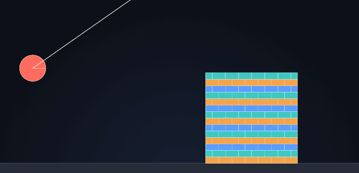
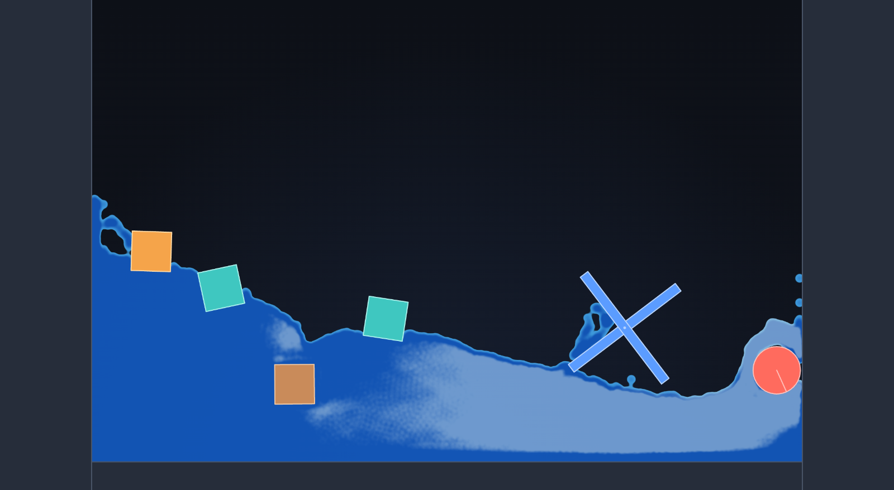
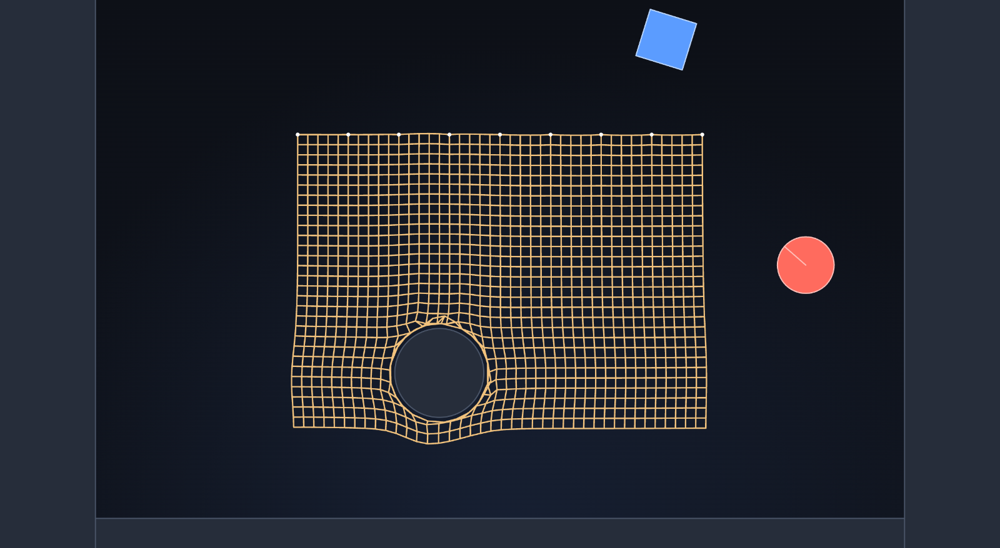
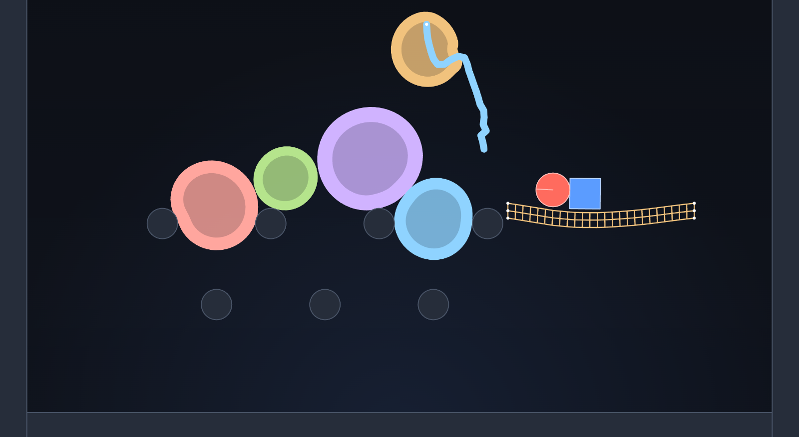
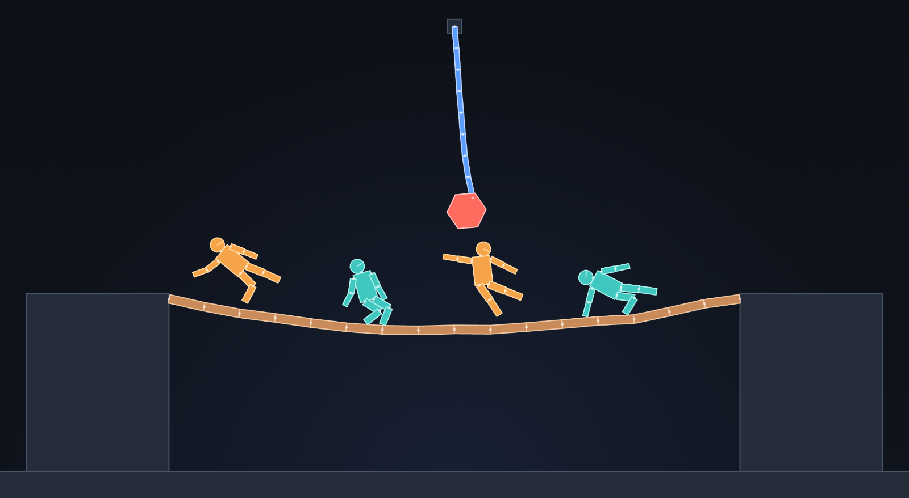
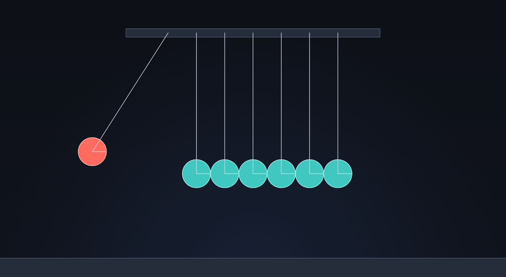
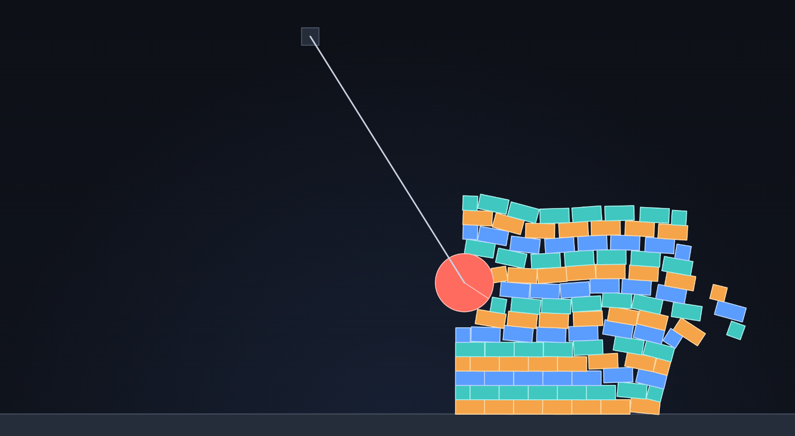
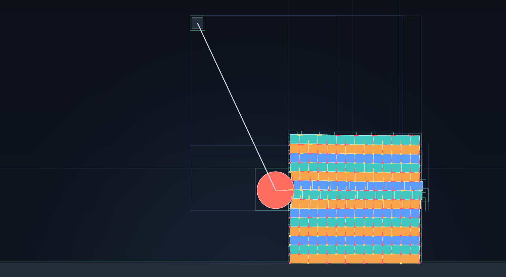

# Zamah

**A real-time 2D physics engine written from scratch: rigid bodies, cloth, soft bodies and liquid, with a browser sandbox where you build things and knock them down.**

**[Open the sandbox](https://hericnino.github.io/zamah/)** &nbsp; [](https://github.com/HericNino/zamah/actions/workflows/ci.yml)



Everything in that clip is this repository: the collision detection, the constraint solver, the integrator and the renderer. The engine is TypeScript with zero runtime dependencies, about 4,600 lines, and it runs the same in a browser tab and in plain Node.

*Zamah* means *momentum*, the swing you take before a throw, in Bosnian, Croatian and Serbian.

## What is in it

| | |
|---|---|
| **Rigid bodies** | Circles and convex polygons, several shapes per body. Stacking, friction, restitution, sleeping. Hinges with limits and motors, rods, ropes, springs. |
| **Collision detection** | Dynamic bounding-box tree for the broadphase; separating axis test with reference-face clipping for the narrowphase; speculative contacts instead of a time-of-impact solver. |
| **Solver** | Sequential impulses with soft constraints, four sub-steps per step, warm starting, a relax pass, and a separate impact pass for restitution. |
| **Cloth and soft bodies** | XPBD: tearable cloth, ropes, pressurised blobs. They collide with rigid shapes and push back on them. |
| **Liquid** | Position based fluids on a spatial hash grid. Bodies float or sink by density. |
| **Sandbox** | Seven scenes, eight tools (grab and throw, spawn, pour, cut, blast, erase), pause and single-step, and a debug view of contacts, the bounding-box tree and per-phase timings. |

| | | |
|---|---|---|
|  |  |  |
| Liquid: 3,367 particles | Cloth: 1,230 particles, 6,999 constraints | Soft bodies and a hammock |
|  |  |  |
| 62 hinges with angle limits | Newton's cradle | 105 bricks, mid-collapse |

## Three things worth a closer look

**1. A Newton's cradle that works.** Most impulse solvers treat bounce as a target velocity fixed at the start of the step, which cannot hand an impact down a row of touching balls: the row turns to mush. Zamah resolves restitution in its own pass, as a sequence of two-body collisions that may chain within one sub-step. One ball in, one ball out, and the test suite checks that the rest stay still to within half a percent. Each of those impulses is a one-dimensional collision with restitution at most 1, so the pass can remove kinetic energy but never add any; a box of 36 perfectly elastic discs keeps its energy to four decimal places through 900 steps and never gains any from one step to the next.

**2. Bit-identical results in different JavaScript engines.** `Math.sin`, `Math.cos`, `Math.pow` and friends may legally differ in the last bit between engines, and a physics simulation amplifies one bit into a different outcome within seconds. The engine therefore uses only operations IEEE 754 defines exactly (`+ - * /` and `sqrt`) and its own trigonometry built from them. `npm run cross-engine` runs every scene in V8 and in JavaScriptCore (Safari's engine) and compares 64-bit hashes of the complete state: identical. The same hashes are checked in CI on x64 Linux against values recorded on an arm64 Mac.

**3. Tests that try to prove something.** Not "does it run", but: does a box slide down a 30° incline with acceleration *g*(sin θ − μ cos θ)? Does a pendulum swing with period 2π√(L/g)? Does a thread with compliance α stretch by *mg*α, whatever the sub-step count? Does the bounding-box tree return exactly what a brute-force scan returns? See [Tests](#tests).

## Run it

Requires Node.js 23.6 or newer (the scripts run the TypeScript sources directly).

```bash
npm install
npm run dev            # sandbox at http://localhost:5173
npm test               # 91 tests
npm run build          # static site in dist/ (86 kB of JavaScript, 31 kB gzipped)
npm run bench          # headless benchmark
npm run cross-engine   # determinism check across JavaScript engines
```

## Use the engine

```ts
import { World, box, circle } from './src/engine/index.ts';

const world = new World({ gravity: { x: 0, y: -10 } });

world.createBody({ type: 'static', position: { x: 0, y: -1 }, shapes: [box(20, 1)] });
const crate = world.createBody({ position: { x: 0, y: 5 }, shapes: [box(0.5, 0.5, { friction: 0.6 })] });
const ball = world.createBody({ position: { x: 0.2, y: 9 }, shapes: [circle(0.4, { restitution: 0.5 })] });

world.createDistanceJoint({ bodyA: crate, bodyB: ball, anchorA: { x: 0, y: 5 }, anchorB: { x: 0.2, y: 9 }, mode: 'rope' });
world.soft.createCloth({ x: -3, y: 8, cols: 30, rows: 20, spacing: 0.2, tearRatio: 3 });
world.fluid.addBlock(-8, 0, 4, 3);

for (let i = 0; i < 600; i++) world.step(); // each step is exactly 1/60 s
console.log(crate.x, crate.y, world.hash());
```

There is no DOM, clock or random number anywhere in `src/engine`, so this runs unchanged in Node, and two runs always end in the same state.

## Performance

Measured with `npm run bench` on an Apple M1 Pro (2021), Node 25.2.1, single thread. One step simulates 1/60 s, so anything under 16.67 ms runs in real time. Sleeping is switched off in the rigid-body cases, so every body is solved every step.

| Case | Size | Median step | 95th percentile |
|---|---|---:|---:|
| Pyramid | 210 boxes, 590 contacts | 1.0 ms | 1.2 ms |
| Pyramid | 1,275 boxes, 3,725 contacts | 6.5 ms | 7.3 ms |
| Pile of mixed shapes | 2,000 bodies, about 7,000 contacts | 14.4 ms | 17.7 ms |
| Bridge and ragdolls scene | 65 bodies, 62 joints | 0.2 ms | 0.3 ms |
| Cloth, 60 x 40 | 2,400 particles, 13,902 constraints | 4.5 ms | 4.8 ms |
| Liquid | 1,932 particles | 4.0 ms | 4.3 ms |
| Liquid | 4,972 particles | 10.9 ms | 11.5 ms |
| Dam break scene | 3,367 particles, 6 bodies | 7.9 ms | 8.2 ms |

With sleeping on, a pyramid at rest costs close to nothing: the 210-box scene in the sandbox idles at about 0.05 ms per step. The 2,000-body pile is at the edge of real time (its slowest steps go over budget); that is the practical limit of this solver on this machine.

## Tests

`npm test` runs 91 tests in about 13 seconds. The interesting ones:

| What is claimed | How it is checked |
|---|---|
| The broadphase never misses a pair | 120 bouncing shapes for 300 steps; every pair whose boxes overlap in a brute-force check must have a contact. The tree itself is compared with a linear scan through 2,400 random inserts, moves and removals. |
| The narrowphase is right | 20,000 random convex polygon pairs against an independent overlap test (edge crossings and containment, no SAT). For 5,000 more, moving one polygon along the reported normal by the reported depth must end the overlap, and half that distance must not. |
| Momentum is conserved | Linear and angular momentum to rounding error through hundreds of collisions between 60 random frictional shapes. |
| Energy is conserved in ideal collisions | Elastic two-body collisions reproduce the textbook velocities to 12 digits. A closed box of elastic discs never gains energy in any of 900 steps. |
| Newton's cradle | One ball in, one out; two in, two out. Total energy within 0.5% over twenty seconds of swinging. |
| Friction is Coulomb friction | Sliding acceleration on an incline matches *g*(sin θ − μ cos θ) to 1%; a box stays put when μ > tan θ; a disc rolls without slipping at ⅔ *g* sin θ. |
| Joints are accurate | Pendulum period within 0.1% of 2π√(L/g); spring frequency; motor torque limit; a 20-link chain keeps its hinges within 5 cm while it cracks like a whip. |
| Stacks are stable | A 12-box stack and a 210-box pyramid, with sleeping disabled, come to a complete stop (below 1e-9 m/s) and stay there for thousands of steps. Without warm starting the same stack sags more than three times deeper. |
| XPBD stiffness is physical | A weight on a thread of compliance α stretches it by *mg*α with 4, 10 or 40 sub-steps alike. |
| Liquid is incompressible and contained | A dam break settles to rest density ±3%, at the depth conservation of area predicts, with no particle outside the tank. Light bodies float, heavy ones sink. |
| Determinism | Two runs of every scene agree bit for bit at every step. Recorded hashes must match on other machines. A source scan fails the build if the simulation calls a `Math` function with unspecified rounding. |
| Robustness | 80 random worlds (overlapping spawns, random joints, cloth, liquid) are poked at random with blasts, deletions and gravity flips: no NaN, no speed above the limit, nothing leaves a closed room. Replaying a seed reproduces the run exactly. |

These tests paid for themselves while the engine was being written. The incline test showed friction was several percent too weak. The momentum test showed angular momentum drifting by 3%. The rolling test exposed a hidden rolling resistance. The fuzzer found a broadphase bug (a body given a large velocity between steps was not paired with the wall in front of it) and a speed limit the constraint solver could exceed. Each of those is now a fixed bug and a line in the [architecture notes](docs/ARCHITECTURE.md).

## Sandbox controls

| | |
|---|---|
| **Tools** | Grab `G`, Box `B`, Ball `C`, Polygon `P`, Water `W`, Cut `X`, Blast `E`, Erase `Backspace`. Spawn tools throw when you drag. |
| **Time** | `Space` pauses, `.` advances one step, `R` rebuilds the scene, `1` to `7` switch scenes. |
| **View** | Mouse wheel zooms, dragging empty space (or the right button) pans. |
| **Debug** `D` | Contact points and normals, the bounding-box tree, joints, sleeping bodies, particles; per-phase timings; sub-step count; switches for warm starting, sleeping and gravity; the state hash. |



*The debug view, a moment after impact: contact points with their normals (red where they carry load, yellow where they are still speculative), and the boxes of the broadphase tree.*

Turn off warm starting in the Pyramid scene and watch it sag: that one checkbox is the best argument for why the technique exists.

The liquid is drawn with WebGL2 (particles are splatted into a density texture and thresholded into a surface). If WebGL2 is missing or the context is lost, the sandbox falls back to plain Canvas 2D discs; add `?fluid=2d` to the address to see that path. The simulation itself never touches the GPU, so both look at the same physics.

## Limitations

Stated plainly, because knowing where an engine stops is part of understanding it.

- **No continuous collision detection.** Contacts are created before shapes touch (speculative contacts, with a margin that grows with speed), which stops a 100 m/s bullet at a 20 cm wall in the tests. But collision detection runs once per step, so a body that is knocked into a new direction mid-step can end up inside a thin object. The arenas in the scenes have walls 10 m thick for that reason.
- **Shapes** are circles and convex polygons of up to eight vertices. No concave shapes, capsules or edge chains; build those from several shapes on one body.
- **Joints**: hinge, distance (rod, rope, spring) and mouse. No slider, weld, wheel or gear.
- **Mass ratios.** A heavy box rests calmly on a light one up to about 40:1 with the default four sub-steps, 100:1 with eight. Beyond that it jitters. Hinges whose lever arms are many times longer than the bodies they connect can go unstable.
- **Resting penetration.** Contacts are soft springs. A box sinks 5 to 10 mm into what it rests on, more under load: the top of a 14-row brick wall settles by about 10 cm.
- **Bounce** below 1 m/s is treated as no bounce, so things come to rest. Under gravity an elastic ball returns to between 99% and 100% of its drop height, alternating, which is the integrator's half-step offset rather than a loss.
- **Cloth** does not collide with itself, and its particles collide as discs, so a sharp corner can slip between two of them. Cloth can stop and carry a rigid body but will not launch one: the hand-over of momentum to the body is deliberately capped (see the architecture notes), which makes trampolines weak.
- **Liquid** is weakly compressible (a few percent), has no surface tension, and does not interact with cloth. Buoyancy comes from particles pressing on a body, so a light body lying flat on the floor with no liquid under it stays there. Particles are limited to one spacing per sub-step (about 17 m/s in the dam break scene).
- **Determinism** means: same build, same calls, same bits. The sandbox feeds mouse input at whatever moment the browser delivers it, so an interactive session is not replayable; scenes left alone are.
- **Performance** is single-threaded JavaScript without SIMD. The contact solver is the bottleneck above roughly 2,000 active bodies.

## How this was built

This project was built with heavy use of an AI coding assistant (Claude). The design decisions, the test strategy and the trade-offs were worked through in conversation, and I can explain every part of it: [docs/ARCHITECTURE.md](docs/ARCHITECTURE.md) records each decision with its reason, including the approaches that were tried and thrown away, and ends with the questions I expect to be asked about it.

Nothing here is copied from an existing engine, but the ideas are standing on well-known work: Erin Catto's sequential impulses and soft-step solver (Box2D), Müller and Macklin's position based dynamics, XPBD and position based fluids, and Guendelman, Bridson and Fedkiw's separation of collision from contact.

## Layout

```
src/engine/     the engine; no DOM, no dependencies
  math/         vectors, deterministic trigonometry, seeded random numbers, state hashing
  collision/    shapes, dynamic AABB tree, broadphase, manifolds (SAT and clipping)
  dynamics/     bodies, contacts, the contact solver, joints
  particles/    XPBD cloth and soft bodies, position based fluid, neighbour grid, coupling
  world.ts      one fixed step: broadphase, narrowphase, islands, solver, particles
src/scenes/     the seven scenes; engine calls only, shared by sandbox, tests and benchmark
src/sandbox/    browser front end: camera, Canvas 2D renderer, WebGL2 liquid, tools, UI
tests/          91 tests
bench/          benchmark, golden hashes, cross-engine check
docs/           architecture notes
```

## License

MIT
